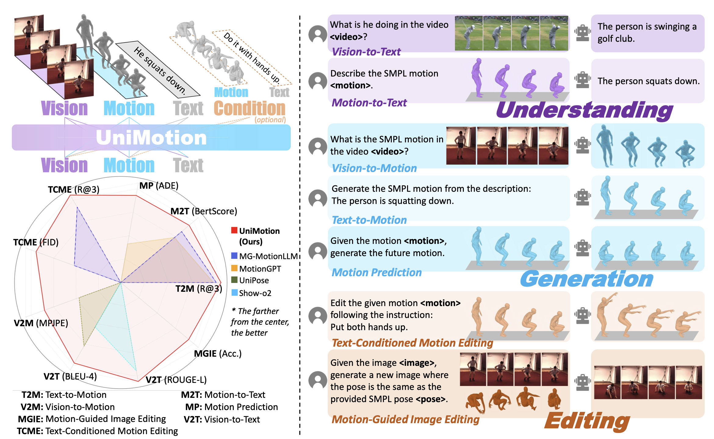
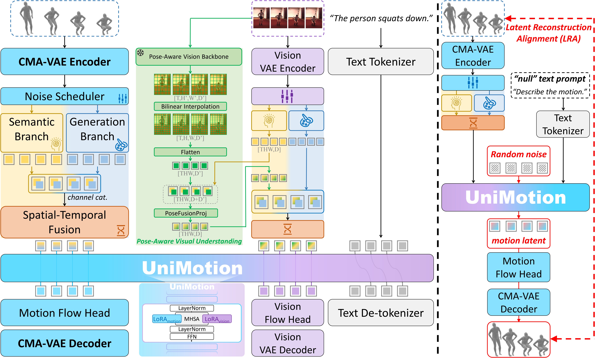

# TrajGS

基于 [UniMotion](https://github.com/wangzy01/UniMotion) 初始化的研究框架。
默认开发环境为 **`trajgs`（Python 3.12 / PyTorch 2.15 / CUDA 13.2）**；
另保留 **`unimotion`** 环境用于复现上游标准配置。

仓库来源、环境激活、重建与验收方法见 [初始化说明](docs/bootstrap.md)。

```bash
source scripts/activate_env.sh  # 默认 trajgs
```

以下保留上游项目说明。

---

# UniMotion

**UniMotion: A Unified Framework for Motion-Text-Vision Understanding and Generation**

[](https://arxiv.org/abs/2603.22282) [](https://wangzy01.github.io/UniMotion/)

Official repository for the ECCV 2026 paper **"UniMotion: A Unified Framework for Motion-Text-Vision Understanding and Generation"**.

## Overview

UniMotion is a unified framework for motion-text-vision understanding, generation, and editing. It treats motion as a continuous modality on equal footing with images: motion sequences are encoded by CMA-VAE (Cross-Modal Aligned Motion VAE, trained with Dual-Posterior KL Alignment) into continuous latents, mapped by a dual-path embedder, processed by a shared LLM backbone with hybrid attention and modality-routed LoRA, and decoded through modality-specific flow heads.



## Method



## Installation

```bash
conda create -n unimotion python=3.10 -y
conda activate unimotion
# Install PyTorch 2.5.1 matching your CUDA version first, then:
pip install -r requirements.txt
python -m spacy download en_core_web_sm
export WANDB_MODE=offline  # if you do not use Weights & Biases
```

> **Note:** the local package `datasets/` shares its name with HuggingFace `datasets`. Always launch training/evaluation from the repository root so the local package takes precedence.

## External Assets

| Asset | Location expected by configs | How to get it |
|---|---|---|
| Show-o2 1.5B base | auto-downloaded (`showlab/show-o2-1.5B`) | HuggingFace Hub |
| Qwen2.5-1.5B-Instruct (LLM / tokenizer) | auto-downloaded | HuggingFace Hub |
| SigLIP so400m | auto-downloaded (`google/siglip-so400m-patch14-384`) | HuggingFace Hub |
| WAN 2.1 image VAE | `Wan2.1_VAE.pth` (repo root) | from `Wan-AI/Wan2.1-T2V-1.3B` on HuggingFace (only needed for Stage 2+, i.e. vision tasks) |
| TokenHMR pose backbone | `deps/pose/tokenhmr_model.ckpt` | download the checkpoint (`tokenhmr_model_latest.ckpt`) from the [TokenHMR](https://github.com/saidwivedi/TokenHMR) release (registration required; research-only license) and rename it to `deps/pose/tokenhmr_model.ckpt` (only needed for Stage 2+) |
| CMA-VAE checkpoint | `pretrained/cma_vae.ckpt` | download from [Baidu Netdisk](https://pan.baidu.com/s/1pyUxi7eKmptSCaGw9xypDg) (code: `gg72`) or train with [`cma_vae/`](cma_vae/) (see its README) |
| T2M evaluator + GloVe | `deps/t2m/t2m/`, `deps/glove/glove/` | `bash scripts/setup_t2m_eval_deps.sh` checks the layout and prints instructions; download `finest.tar`, `Comp_v6_KLD01/meta/{mean,std}.npy` and the processed `glove` folder (`our_vab_*`) manually from [HumanML3D](https://github.com/EricGuo5513/HumanML3D) |

## Data Preparation

All tasks consume a unified **269-dim motion representation** (263-dim HumanML3D-compatible features + 6-dim global orientation). See [`data_preparation/README.md`](data_preparation/README.md) for the full pipeline from raw HumanML3D / MotionFix / Human3.6M to the expected layout:

```
data/UNI_MOTION_269/
├── HumanML3D/   (new_joint_vecs/ texts/ Mean.npy Std.npy train.txt val.txt test.txt)
├── MotionFix/   (new_joint_vecs/{source,target}/ texts/ Mean.npy Std.npy splits)
└── H36M/        (new_joint_vecs/ image_paths/ text/ Mean.npy Std.npy train.txt test.txt)
```

Reference `Mean.npy` / `Std.npy` files (as used in all our runs) are provided in `data_preparation/precomputed_stats/`.

## Training Pipeline

- `train_stage0.sh` / `train_stage1.sh` / `train_stage2a.sh` / `train_stage2b.sh` / `train_stage3.sh` — positional arguments are **GPU ids** (e.g. `bash train_stage1.sh 4 5` runs on GPUs 4 and 5). Config overrides go after `--`.
- `train_single_task_m2t_a.sh` / `_b.sh` — the first argument is the **number of GPUs** (`NUM_GPUS`); select which GPUs via `CUDA_VISIBLE_DEVICES`, e.g. `CUDA_VISIBLE_DEVICES=0,1,2,3,4,5 bash train_single_task_m2t_a.sh 6`.
- `train_stage4.sh` — positional arguments are **GPU ids**, optionally followed by a **launch mode** as the last argument: `zero2` (default, DeepSpeed ZeRO-2), `zero3`, or `ddp`, e.g. `bash train_stage4.sh 0 1 2 3 zero3`.

```bash
# example: Stage 1a on GPUs 4 and 5, overriding max steps
bash train_stage1.sh 4 5 -- training.max_train_steps=400000
```

> **Note:** the default scripts assume up to 6 GPUs (`GPU_IDS=(0 1 2 3 4 5)` / `NUM_GPUS=6`); pass GPU ids (or `NUM_GPUS`) matching your machine.

Each stage initializes from the previous stage's checkpoint (`model.showo.pretrained_model_path` in each config; LoRA weights are picked up automatically from `lora_weights.pt` next to the checkpoint). Checkpoint numbering counts training iterations.

## Acknowledgements

This codebase builds on [Show-o2](https://github.com/showlab/Show-o), [MLD](https://github.com/ChenFengYe/motion-latent-diffusion), [MotionGPT](https://github.com/OpenMotionLab/MotionGPT), [TokenHMR](https://github.com/saidwivedi/TokenHMR), [HumanML3D](https://github.com/EricGuo5513/HumanML3D), and [MotionFix](https://github.com/atnikos/motionfix). We thank the authors for their open-source contributions.

## Citation

```bibtex
@article{wang2026unimotion,
  title={UniMotion: A Unified Framework for Motion-Text-Vision Understanding and Generation},
  author={Wang, Ziyi and Wang, Xinshun and Chen, Shuang and Cong, Yang and Liu, Mengyuan},
  journal={arXiv preprint arXiv:2603.22282},
  year={2026}
}
```
