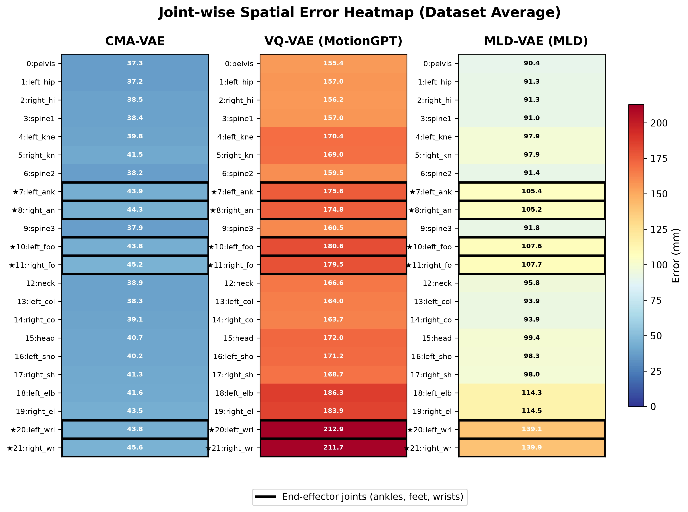

# CMA-VAE (Cross-Modal Aligned Motion VAE)

**CMA-VAE** is the motion VAE used by UniMotion. It encodes 269-dim HumanML3D-format motion features into a compact latent space and is pre-trained with **DPA (Dual-Posterior KL Alignment)**: during training, a **Vision-Fused Motion Encoder** (motion + frozen HRNet image features; "Joint Encoder" in the code) provides a target posterior, and the motion-only **Motion Encoder** is aligned to it via KL divergence (JMVAE-KL style — the historical code name for this model is "KL-Align Motion VAE"). At inference time only the Motion Encoder and the Decoder are used — no images are required.

It is trained jointly on HumanML3D, MotionFix and Human3.6M.

- **Motion Encoder** — Transformer encoder over motion features; outputs a Gaussian posterior `q(z|motion)`.
- **Vision-Fused Motion Encoder** (code: "Joint Encoder") — Transformer encoder over motion features fused with visual features from a frozen HRNet-W32 backbone; outputs `q(z|motion, image)`.
- **Decoder** — Transformer decoder reconstructing motion features from `z`, with optional temporal downsampling of the latent sequence.
- **Losses** (paper: reconstruction + DPA) — feature/joint reconstruction (SmoothL1), KL regularization towards `N(0, I)` for both encoders, and a KL alignment term `KL(q(z|motion) || q(z|motion, image).detach())` with linear warm-up.

### Reconstruction quality

Joint-wise spatial reconstruction error (dataset average, mm) of CMA-VAE compared with the VQ-VAE from MotionGPT and the VAE from MLD; lower is better, end-effector joints (ankles, feet, wrists) are outlined:

<p align="center">
  
</p>

### Paper ↔ code name mapping

Code identifiers keep their historical names so that existing checkpoints remain loadable (pickled checkpoint metadata references the original module paths and class names):

| Paper term | Code |
|---|---|
| CMA-VAE | `CMAVAE` in `models/architectures/mld_vae_kl_align.py` (compat alias `MldVaeKLAlign`) |
| DPA (Dual-Posterior KL Alignment) | `KLAlignLoss` / `kl_align` loss in `models/losses/mld_kl_align.py` |
| Vision-Fused Motion Encoder | `encode_joint` / "Joint Encoder" |
| CMA-VAE losses | `CMAVAELosses` (compat alias `MLDLossesKLAlign`) |
| Lightning wrapper | `MLD_KL_ALIGN` in `models/modeltype/mld_kl_align.py` (resolved from `model_type: mld_kl_align`) |

Internal module file names (`mld_vae_kl_align.py`, `mld_kl_align.py`) are historical implementation file names and are intentionally unchanged — renaming them would break pickled module references in old checkpoints.

## Table of Contents

- [Installation](#installation)
- [Data Preparation](#data-preparation)
- [Pretrained Checkpoint](#pretrained-checkpoint)
- [Training](#training)
- [Inference](#inference)
- [Checkpoint Format](#checkpoint-format)
- [Acknowledgement](#acknowledgement)
- [License and Attribution](#license-and-attribution)

## Installation

All commands in this README are run **from this `cma_vae/` directory** (the package uses absolute imports resolved from the current working directory).

CMA-VAE training only needs a small dependency set; you can either install it into the main `unimotion` environment or create a dedicated one:

```bash
conda create -n cma_vae python=3.11 -y
conda activate cma_vae
pip install -r requirements.txt
```

## Data Preparation

CMA-VAE reads the same 269-dim data tree as the main repository (see [`../data_preparation/README.md`](../data_preparation/README.md) for how to build it). Expected layout, relative to the repository root (paths are configurable in `configs/config_cma_vae.yaml`; defaults use `../` because training runs from `cma_vae/`):

```
UniMotion/
├── data/
│   ├── UNI_MOTION_269/
│   │   ├── HumanML3D/
│   │   │   ├── new_joint_vecs/     # (T, 269) .npy per sequence
│   │   │   ├── Mean.npy  Std.npy
│   │   │   └── train.txt  test.txt
│   │   ├── MotionFix/              # same layout as HumanML3D
│   │   └── H36M/
│   │       ├── new_joint_vecs/     # single big (N, 269) .npy per split
│   │       ├── image_paths/        # per-frame image path arrays
│   │       ├── joints2d_aff448.pkl # precomputed 2D joints (train/test)
│   │       ├── Mean.npy  Std.npy
│   │       └── train.txt  test.txt
│   └── Human3.6M_MMPose/processed/
│       └── images_fps50_cropped_448x448/   # cropped H36M frames
├── deps/
│   └── hrnet/pose_hrnet_w32_256x192.pth    # frozen HRNet-W32 weights
└── cma_vae/                                # this directory
```

HumanML3D and MotionFix provide motion sequences without images. H36M provides single-frame motion paired with images; its precomputed 2D joints (`joints2d_aff448.pkl`) are used for supervision of the vision branch.

The HRNet-W32 weights (`pose_hrnet_w32_256x192.pth`) come from the official [HRNet](https://github.com/leoxiaobin/deep-high-resolution-net.pytorch) release. They are only needed for training (the vision branch); inference never touches them.

## Pretrained Checkpoint

The official CMA-VAE checkpoint (`cma_vae.ckpt`) — the one used by all main-pipeline stage configs — is available at [Baidu Netdisk](https://pan.baidu.com/s/1pyUxi7eKmptSCaGw9xypDg) (code: `gg72`). After downloading, place it at the location the stage configs expect:

```bash
mkdir -p ../pretrained
mv cma_vae.ckpt ../pretrained/cma_vae.ckpt
```

Alternatively, you can train the model yourself following the [Training](#training) section below.

## Training

```bash
cd cma_vae
python train.py \
    --cfg configs/config_cma_vae.yaml \
    --cfg_assets configs/assets.yaml \
    --device 0 1 2 3
```

Notes:

- Debug mode is controlled by `DEBUG` in the config (default `False`). Setting `DEBUG: True` gives a quick debug run: the experiment name is prefixed with `debug--`, wandb is forced offline, and validation runs every epoch. Passing `--nodebug` forces debug mode off regardless of the config.
- Checkpoints are saved to `experiments/mld_kl_align/<NAME>/checkpoints/` every `LOGGER.SAVE_CHECKPOINT_EPOCH` epochs; losses are logged to TensorBoard. (The `mld_kl_align` path segment comes from `model_type`, which is kept for checkpoint compatibility.)
- The default config (`downsample_rate: 4`) is the variant used by all main-pipeline configs.
- To fine-tune from a pretrained VAE, set `TRAIN.PRETRAINED_VAE` in the config.
- Multi-GPU training uses DDP; the frozen HRNet requires `find_unused_parameters` (handled automatically).

### Using the trained checkpoint in the main pipeline

The main UniMotion pipeline only needs the checkpoint this package produces. Copy your chosen epoch checkpoint to the location expected by the stage configs (`model.motion_vae.pretrained_model_path`):

```bash
mkdir -p ../pretrained
cp experiments/mld_kl_align/<NAME>/checkpoints/epoch=<N>.ckpt ../pretrained/cma_vae.ckpt
```

## Inference

`inference.py` loads VAE weights from a checkpoint, reconstructs a 269-dim HumanML3D-format motion sequence (encode → decode), and recovers 22-joint 3D coordinates. Only the Motion Encoder and Decoder are used; no image / HRNet input is required.

### 1. Reconstruct a Motion Sequence

```bash
cd cma_vae
python inference.py \
    --ckpt ../pretrained/cma_vae.ckpt \
    --motion ../data/UNI_MOTION_269/HumanML3D/new_joint_vecs/000000.npy \
    --stats_dir ../data/UNI_MOTION_269/HumanML3D \
    --out_dir ./infer_out
```

The model variant (`downsample_rate`, dims) is detected automatically from the checkpoint weights. Reported metrics: feature-space MSE and MPJPE.

Arguments:

| Argument      | Description                                                      |
| ------------- | ---------------------------------------------------------------- |
| `--ckpt`      | checkpoint path (`.ckpt`)                                        |
| `--motion`    | motion `.npy` file of shape `[T, 269]` (`new_joint_vecs` format) |
| `--stats_dir` | directory containing the dataset's `Mean.npy` / `Std.npy`        |
| `--out_dir`   | output directory (default `./infer_out`)                         |
| `--device`    | e.g. `cuda:0` or `cpu` (default: auto)                           |
| `--sample`    | sample from the posterior instead of using its mean              |

Outputs written to `<out_dir>`:

| File                      | Content                                    |
| ------------------------- | ------------------------------------------ |
| `<name>_recon_feats.npy`  | reconstructed 269-dim features (raw scale) |
| `<name>_recon_joints.npy` | reconstructed joints `[T, 22, 3]`          |
| `<name>_latent.npy`       | latent codes `[L, latent_dim]`             |

### 2. Use the VAE in Your Own Code

```python
from inference import load_pretrained_vae

vae = load_pretrained_vae("../pretrained/cma_vae.ckpt", device="cuda")
latent, dist = vae.encode_motion(motion, lengths)   # motion: [B, T, 269], normalized
recon = vae.decode(dist.loc, lengths)               # [B, T, 269]
```

## Checkpoint Format

Checkpoints produced by `train.py` are PyTorch Lightning checkpoints whose `state_dict` stores the VAE under `vae.*` keys. The main repository's loader (`load_motion_vae` in `models/motion_vae/__init__.py`) accepts these directly: model hyper-parameters are inferred from the weight shapes when checkpoint metadata is absent, and the frozen HRNet backbone (`vae.vision_backbone.*`) is ignored on both sides. A stripped, pure-weight file (`{'state_dict': {'vae.*': tensor}}`, loadable with `torch.load(path, weights_only=True)`) works as well.

## Acknowledgement

This codebase builds upon and draws inspiration from the following open-source projects:

- [MLD](https://github.com/ChenFengYe/motion-latent-diffusion)
- [HumanML3D](https://github.com/EricGuo5513/HumanML3D)
- [HRNet](https://github.com/leoxiaobin/deep-high-resolution-net.pytorch)

## License and Attribution

Parts of the code in this directory are derived from the [MLD (Motion Latent Diffusion)](https://github.com/ChenFengYe/motion-latent-diffusion) project, which is released under the MIT License. The original copyright of the MLD authors is retained for those portions; see the MLD repository for the full license text.
