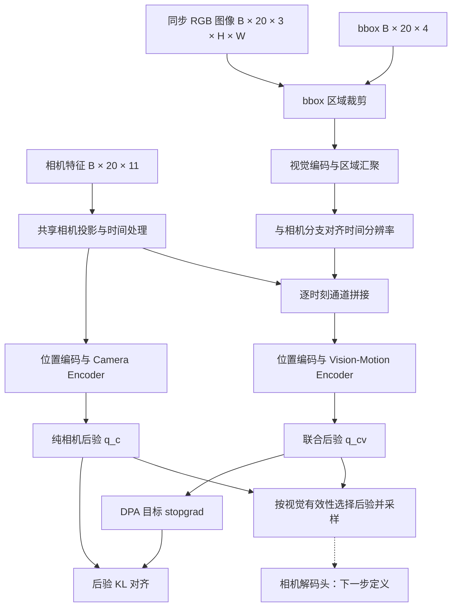

# TrajGS：基于场景图像与拍摄指令的相机轨迹生成计划

## 问题定义

训练一个模型，根据拍摄任务的文本指令和真实场景重建后的重采样参考图像，生成符合拍摄要求的相机轨迹位姿序列。参考 UniMotion 的连续 latent 建模方式，先建立相机轨迹的 CMA-VAE 表示，再逐步接入条件生成模型。

当前约定：一条轨迹暂定包含 **20 个按时间排列的相机位姿**；每个位姿用一个 **11D 特征向量**表示。20 表示序列长度，不表示 20 FPS、20 个独立样本或 20 维特征。11D 的分量含义、坐标系、归一化和实际相机参数转换由后续相机模块定义。

每个位姿有一张同步拍摄图像和一个 2D bbox。从 bbox 框定的图像区域提取视觉特征，并将它与对应时刻的相机特征一起送入 Vision-Motion Encoder。此处的 segment 暂指 bbox 对应的区域；bbox 不等同于像素级分割 mask，本轮不假设额外分割标注或分割模型。

**本轮范围：计划文档、原版 CMA-VAE 迁入、原版与目标方案对比页。** 根目录 `cma_vae/` 是原样迁入的基线；本文的相机适配是目标设计，尚未写入模型代码。相机解码头、本体相机模块、LLM、双路径 Embedder、Flow Head 均留到后续。

## 1. 数据读取

### 1.1 样本与 batch 接口（目标约定，尚未实现）

记 batch 大小为 B，序列长度为 T=20，图像高宽为 H、W。

| 字段 | 单样本 | batch | 含义 |
| --- | --- | --- | --- |
| `text` | 字符串 | B 个字符串 | 拍摄任务指令，供后续条件生成使用 |
| `camera_features` | `[20, 11]` | `[B, 20, 11]` | 按时间排列的相机特征 |
| `images` | `[20, 3, H, W]` | `[B, 20, 3, H, W]` | 各相机时刻对应的 RGB 图像；channels-first 为拟采用的内部接口 |
| `bboxes` | `[20, 4]` | `[B, 20, 4]` | 各图像中的目标区域；坐标格式与单位待数据接入时确定 |
| `lengths` | `20` | `[B]` | 有效序列长度，保留后续变长扩展入口 |
| `frame_mask` | `[20]` | `[B, 20]` | 有效相机时刻，完整序列全部有效 |
| `visual_mask` | `[20]` | `[B, 20]` | 有效图像与 bbox，区别于轨迹本身是否有效 |
| `scene_id` / `sample_id` | 标识 | B 个标识 | 场景划分、配对与数据追踪 |
| `timestamps` | `[20]`，若有 | `[B, 20]`，若有 | 真实采样时间；尚不假定等间隔 |

字段名和图像布局是规划接口，不是已有 Dataset 的 API。原版 loader 的人体特征、图像布局与本接口不同，不能直接替代。

### 1.2 读取与对齐流程

1. 读取文本、相机序列、图像和 bbox，绑定同一 `sample_id`。
2. 用同一时间索引选取相机、图像、bbox；采样到 20 个时刻时保持三者同步。
3. 按约定坐标系裁剪 bbox 区域，统一图像尺寸后提取区域视觉特征。
4. 若图像经过缩放、裁剪或增强，同步变换 bbox；不直接把原图坐标用于变换后的图像。
5. collate 生成相机特征、图像、bbox 和 mask；区分无效 bbox、缺失图像和 padding。
6. 训练/验证/测试优先按重建场景划分，避免同一场景的相邻视图跨集合泄漏。

区域提取的初始方案为 **bbox crop → 图像编码器 → 区域 token 汇聚 → 特征投影**。视觉 backbone、裁剪分辨率、是否冻结、汇聚方式与特征维度等待后续确定；ROIAlign 可作为候选实现，不在本轮定案。

### 1.3 条件与监督的边界

训练样本可以同时提供目标轨迹和每个位姿对应的图像，以训练联合后验。最终生成时可用的参考图像集合需要单独定义：来自已知参考相机、预采样场景视图，还是生成过程中的重渲染，目前待定。

不能默认“待生成轨迹的全部真值位姿及对应视图”在推理时已经可用。数据接口后续应区分 `conditioning_views` 与 `target_camera_features`；它们目前是设计角色，尚未实现。推理条件的视图数量也不因此自动固定为 20。

## 2. 模型

### 2.1 原版 CMA-VAE 基线

来源：`submodules/Unimotion/cma_vae/`，本地来源 checkout 为 `a3769e9c1acbd28c9a5ce1761cecc778c7863fc6`。本轮按原相对路径复制 54 个受版本控制文件至根目录 `cma_vae/`；另附上游根目录 LICENSE。来源和逐文件 SHA-256 见 [迁入清单](cma-vae-import-manifest.json)。

原版默认配置使用 `D_motion=269`、`d_z=256`、`d_visual=128`、`downsample_rate=4`。令 `L=ceil(T/4)`，编码器内部 latent 排列为 `[L, B, 256]`，数据入口是 batch-first。

| 路径 | 原版实际计算 |
| --- | --- |
| Motion Encoder | 人体动作 `[B,T,269]` → Linear → 时间下采样 → 位置编码 → SkipTransformer → `μ_m, logvar_m` → `q_m(z|M)` |
| 视觉路径 | 单帧 RGB → 冻结 HRNet → 在 22 个关节位置采样 → VisionEncoder → 关节维度池化 → 单帧特征广播到 L 个 latent 时刻 |
| Vision-Motion Encoder | 共享动作前端特征 `[B,L,256]` 与视觉特征 `[B,L,128]` 拼接 → 独立 SkipTransformer → `μ_mv, logvar_mv` → `q_mv(z|M,I)` |
| latent 选择 | 有图样本选联合后验采样，无图样本选纯动作后验采样 |
| 共享 Decoder | latent → 位置编码 / Transformer → 时间上采样 → 输出 269D 动作特征 |
| DPA | `KL(q_m || stopgrad(q_mv))`，使纯动作后验靠近视觉融合后验 |

两个后验分别有标准正态 KL 约束；共享 Decoder 接受重建监督。`stopgrad` 只作用于 DPA 的目标分布，联合编码器仍通过重建和先验 KL 训练。代码混合 batch 中存在联合后验时，DPA 计算覆盖整批，并非严格按 `has_video` 筛选。

关键源码位置：

- [CMAVAE 与两个编码器](../cma_vae/models/architectures/mld_vae_kl_align.py)：`encode_motion`、`get_vision_feats`、`encode_joint`、`forward`。
- [DPA 与重建损失](../cma_vae/models/losses/mld_kl_align.py)：`CMAVAELosses.compute_loss`。
- [默认参数](../cma_vae/configs/config_cma_vae.yaml)。

### 2.2 相机 CMA-VAE 目标方案

沿用“双后验＋视觉引导对齐”的机制，把人体动作序列换成相机特征序列。命名中的 Motion 暂保留为轨迹运动含义；代码文件名暂不重命名。



上图是目标设计，未表示代码已经完成适配。

- **Camera Encoder：** 输入 `C ∈ R^[B,20,11]`，输出 `q_c(z|C)`。仅约定输入维度，不解释 11D 的组成。
- **Vision-Motion Encoder：** 输入相机前端特征与 bbox 区域特征，输出 `q_cv(z|C,I,boxes)`。此处的 joint 表示模态联合，不再表示人体关节。
- **逐时刻配对：** 在时刻 i，将相机特征 `h_c[i]` 与对应区域视觉特征 `h_v[i]` 沿通道拼接，再送入时序 Transformer。不得沿时间拼接成 40 个时刻，也不得仅抽第一张图广播到全部时刻。
- **区域语义：** 区域来源是用户提供的 bbox，不需要从 11D 相机向量恢复人体骨架或投影 22 个关节。
- **文本位置：** `text` 保留在样本中，供后续指令条件生成模块使用；原版 CMA-VAE 没有文本编码输入，本轮不强行给 VAE 增加文本路径。
- **解码边界：** 原版 Decoder 随源码保留，但它仍是人体动作重建基线。相机 Decoder 的结构、输出解释与损失本轮不定义，也不以改一个输出维度代替相机模块设计。

### 2.3 时间轴与维度

| 项目 | 原版默认 | 相机目标方案 |
| --- | --- | --- |
| 原始序列特征 | `[B,T,269]` | `[B,20,11]`，已确定 |
| 视觉序列 | 单帧特征广播 | 每时刻独立区域特征 `[B,20,d_v]` |
| latent 长度 | `L=ceil(T/4)` | 现阶段 r=1，L=20；尚未修改代码 |
| latent 维度 | 256 | 暂沿用 256 作为设计起点，后续验证 |
| 视觉特征维度 | 128 | `d_v` 待定；128 可作迁移基线 |
| Transformer 内部布局 | `[L,B,d]` | 保留原接口布局，避免与 batch-first 输入混淆 |

后续分析中已确定首版使用 `r=1` 保留 20 个时刻。该约定尚未写入配置，当前阶段先分析两个编码器的架构。若沿用原版 `r=4`，20 个相机时刻只对应 **5 个 latent 时刻**；相机与视觉分支必须按同一时间分组压缩，并处理 mask，不能把 `[B,5,d_c]` 与 `[B,20,d_v]` 直接拼接。

对于部分图像缺失的轨迹，联合编码的有效性、缺失特征处理和 DPA mask 必须显式设计。不能直接沿用原版的单个样本级 `has_video` 来表达逐帧有效性。

### 2.4 本轮迁入的文件结构

```text
cma_vae/
├── models/
│   ├── architectures/   # CMAVAE、HRNet、视觉工具、Transformer 工具
│   ├── operator/        # 注意力、位置编码、时间处理依赖
│   ├── losses/          # 先验 KL、DPA、人体重建损失
│   ├── modeltype/       # 原版 Lightning wrapper
│   └── get_model.py
├── data/                # 原版人体数据读取，后续替换
├── configs/             # 原版配置，尚非相机训练配置
├── callback/
├── utils/
├── train.py
├── inference.py
├── config.py
├── requirements.txt
├── README.md            # 原版说明保持原样
├── LICENSE              # 从上游根目录附带
└── IMPORT.md            # 本项目的迁入边界与使用说明
```

保留 `cma_vae/` 内部辅助文件以保持包结构完整；不迁入外层 UniMotion 的 LLM、双路径 Embedder、Flow Head 或其他项目。人体关节工具、loader 和 loss 暂时保留，不代表后续相机模型会使用它们。

## 3. 训练

### 3.1 阶段安排

| 阶段 | 内容 | 当前状态 |
| --- | --- | --- |
| 基线迁入 | 原样复制 CMA-VAE，记录来源，核对代码与结构 | 本轮完成 |
| 相机表示适配 | 11D 入口、20 时刻、逐帧 bbox 视觉特征、mask | 待实现 |
| 相机解码与 VAE 预训练 | 定义 Decoder、相机重建项、先验 KL、DPA | 下一步讨论；当前不启动训练 |
| 拍摄指令条件生成 | 明确推理参考视图，接入文本、连续 latent 生成模块 | 后续模块，本轮不迁入 |

CMA-VAE 建立连续轨迹表示，本身不能单独完成“文本＋图像 → 新轨迹”。最终指令生成需要后续条件生成阶段。

### 3.2 拟保留的训练机制

目标预训练损失保留以下结构，具体权重和重建项待 Decoder 确定：

```text
L = L_camera_reconstruction（待定义）
  + λ_prior · [KL(q_c || N(0,I)) + KL(q_cv || N(0,I))]
  + λ_DPA · KL(q_c || stopgrad(q_cv))
```

联合后验由重建与先验 KL 训练；DPA 引导纯相机后验。若没有相机重建约束，仅依赖 KL 不足以建立有用的轨迹表示，因此本轮不把编码骨架称为“可训练完成的相机 VAE”。

后续不沿用人体关节重建、HumanML3D 反归一化或 MPJPE 作为相机训练目标。需要针对相机模块另外定义重建和评估方式。

### 3.3 后续验收点

- 数据读取能证明相机、图像、bbox 的 20 个时刻逐项对应。
- 能观察 bbox crop 的可视化与输入 mask；越界和无效框有明确处理。
- 两个编码器输出合法的高斯分布参数，latent 长度与时间压缩率一致。
- 视觉分支处理完整图像序列，不发生单帧广播替代逐帧条件。
- DPA、先验 KL 与未来相机重建损失的梯度流符合定义。
- 目标生成推理不依赖未知的真值相机轨迹或由它才能取得的目标视图。

## 本轮交付与验证

- [x] 本文按数据读取、模型、训练三个模块组织。
- [x] 根目录 `cma_vae/` 保留上游文件架构，54 个原文件逐字节一致。
- [x] 生成来源清单，保留上游版权说明与 LICENSE。
- [x] 为迁入的 Python 文件完成语法解析检查。
- [x] [原版与相机目标方案 HTML 对比](html/cma-vae-camera-framework/index.html)。
- [ ] 相机适配 forward、训练与数值正确性验证：等待后续实现。

工作区根目录已初始化独立 Git 仓库，远程为 `https://github.com/lys5588/trajgs-model.git`；三个参考仓库通过 `.gitmodules` 与固定提交索引管理。UniMotion 的环境初始化版本通过 `reference/unimotion-bootstrap` 分支发布，首次推送时需先发布该分支。获取与更新方式见[项目说明](../README.md)。代码迁入校验不等于训练跑通；未安装或启动模型训练依赖，也未下载权重。

## 编码器架构分析阶段

当前只分析网络，不修改模型代码。后续实现目标已确定为 `[B,20,11]`、时间不下采样、逐帧 bbox 区域特征与相机特征融合；解码头暂时不动，先验证两个 encoder 的 forward。

[模块架构图册](html/module-architectures/index.html) 持续收录已用模块与参考模块，首批为 CMA-VAE Motion Encoder 和 DA3 CameraEnc。DA3 当前使用 9D 参数与确定性 token，不能直接视作本项目的 11D 高斯后验编码器。
